# Mise en place du protocole SSH

**DGI-ESP / UCAD - L3 GLSI - 2026-2027**
**Services Réseaux Avancés** - TP : installation du serveur SSH, connexion client, clés SSH et tunnels

Auteurs : Ahmed Mouhamed Moustapha Diop et Abdoulaye Diémè
Enseignant : Dr. GUEYE

Version PDF du rapport : [Rapport_TP_SSH_Diop_Dieme.pdf](Rapport_TP_SSH_Diop_Dieme.pdf)

---

## Introduction

Ce TP met en place le protocole SSH (Secure Shell), qui permet d'accéder de façon sécurisée à une machine distante. Le travail est réalisé en binôme par Ahmed Mouhamed Moustapha Diop et Abdoulaye Diémè. Il couvre quatre étapes : l'installation du serveur SSH sur une machine Linux, la connexion d'un client Windows, la configuration d'une paire de clés SSH avec un client Linux, puis la création de tunnels SSH pour accéder à un serveur web (Apache) et à une base de données (MariaDB). Pour chaque étape, le rapport donne les commandes lancées, les captures des sorties obtenues et une explication.

### Environnement utilisé

Les deux machines Linux sont des machines virtuelles VirtualBox en mode « Accès par pont », ce qui les place sur le même réseau que le PC Windows hôte. Le sujet indique les adresses 192.168.1.169 (serveur) et 192.168.1.168 (client Linux) ; ce sont celles du réseau du laboratoire. Sur notre réseau local, les machines ont reçu des adresses en 192.168.2.x, et ce sont ces adresses qui sont utilisées dans tout le rapport.

| Machine | Système | Adresse IP | Utilisateur | Rôle |
|---|---|---|---|---|
| ubuntu | Ubuntu 26.04 (VM) | 192.168.2.114 | diopa | Serveur SSH |
| dieme | Debian 13 (VM) | 192.168.2.115 | abdoulaye | Client SSH Linux |
| PC hôte | Windows 11 Famille | 192.168.2.112 | diopa | Client SSH Windows |

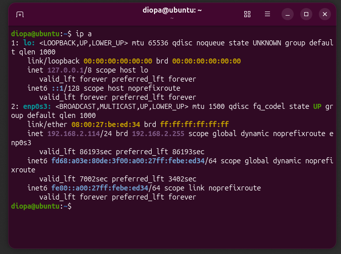

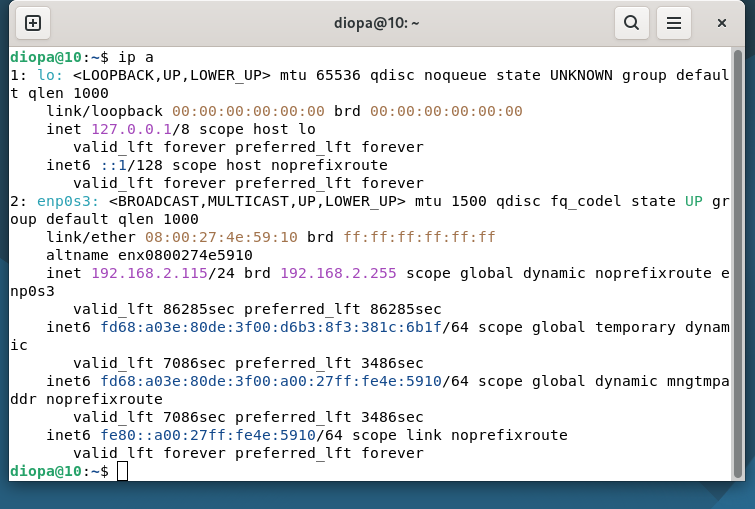

## 1. Étape 1 : installation du serveur SSH

Sur la machine Linux qui joue le rôle de serveur (Ubuntu), on installe le paquet `openssh-server`, on active le service au démarrage et on le démarre :

```bash
sudo apt update
sudo apt install openssh-server
sudo systemctl enable ssh
sudo systemctl start ssh
```

On vérifie ensuite que le port 22 est ouvert, c'est-à-dire que le démon `sshd` est à l'écoute :

```bash
ss -tlnp | grep :22
```

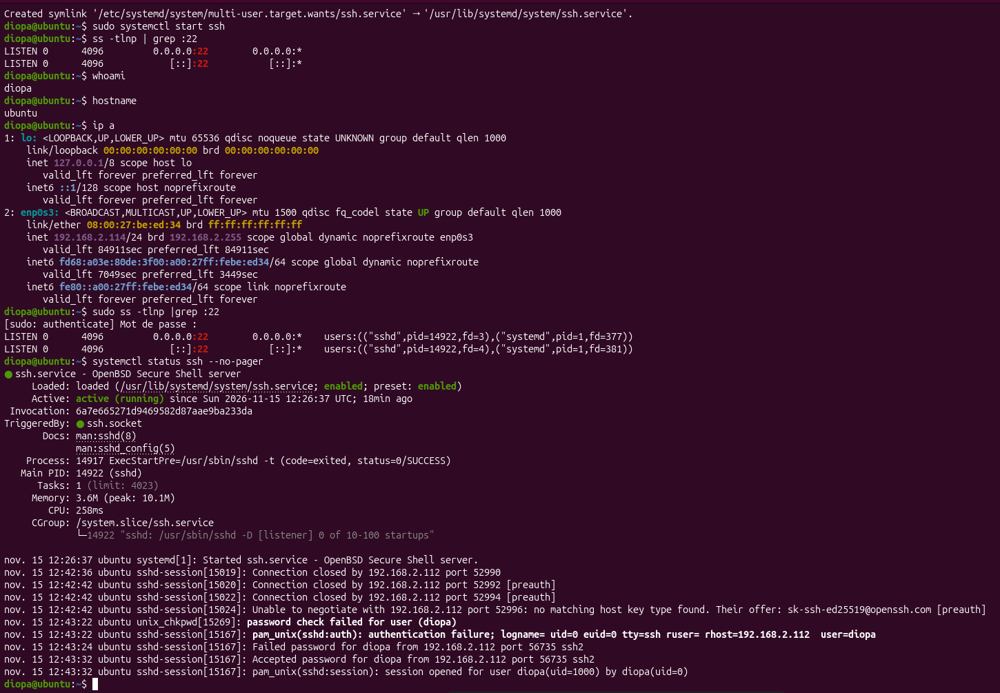

**Observation.** Le service `ssh.service` est `enabled` et `active (running)`. La commande `ss` montre que `sshd` écoute sur `0.0.0.0:22` (IPv4) et `[::]:22` (IPv6), donc sur toutes les interfaces de la machine. Les dernières lignes du journal montrent déjà la connexion de l'étape suivante : « Accepted password for diopa from 192.168.2.112 ».

## 2. Étape 2 : connexion SSH depuis le client Windows

Depuis le PC Windows (PowerShell, client OpenSSH intégré à Windows), on vérifie d'abord que le serveur est joignable, puis on se connecte avec la syntaxe `ssh utilisateur@adresse_ip_du_serveur` :

```powershell
ipconfig | findstr IPv4
ping -n 2 192.168.2.114
ssh diopa@192.168.2.114
```

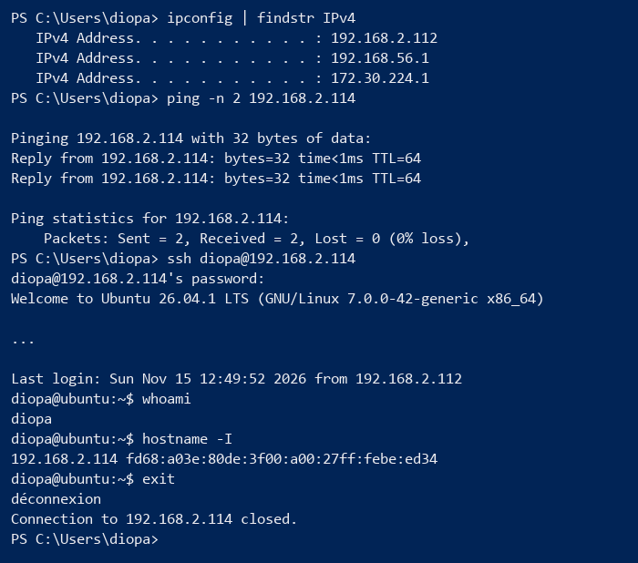

**Observation.** Le `ping` répond sans aucune perte (0 %). À la première connexion, SSH affiche l'empreinte (fingerprint) de la clé du serveur et demande confirmation : après la réponse `yes`, la clé est enregistrée dans le fichier `known_hosts` du client, et la question n'est plus posée aux connexions suivantes. Après la saisie du mot de passe, le prompt devient `diopa@ubuntu:~$` : les commandes sont maintenant exécutées sur le serveur. `whoami` renvoie `diopa`, `hostname -I` renvoie 192.168.2.114, et `exit` ramène au prompt PowerShell. Le mot de passe et toutes les données échangées sont chiffrés, contrairement à Telnet.

## 3. Étape 3 : configuration des clés SSH

L'authentification par clés remplace le mot de passe par une paire de clés : une clé privée, qui reste secrète, et une clé publique, que l'on dépose sur la machine à laquelle on veut se connecter. Ici, le serveur Ubuntu (192.168.2.114) génère la paire de clés et se connecte au client Linux Debian (192.168.2.115).

### 3.1 Génération de la paire de clés sur le serveur

```bash
ssh-keygen -t ed25519
ls -l ~/.ssh/
cat ~/.ssh/id_ed25519.pub
```

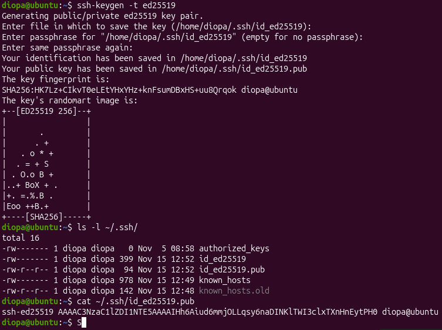

**Observation.** Le fichier `id_ed25519` est la clé privée (droits `-rw-------`, lisible par son seul propriétaire) et `id_ed25519.pub` la clé publique (`-rw-r--r--`). La clé publique est une ligne de texte qui commence par `ssh-ed25519` et se termine par `diopa@ubuntu`. Aucune phrase secrète n'a été définie, afin que la connexion se fasse ensuite sans rien saisir. Le type ed25519 a été préféré à RSA : il est plus récent, plus court et aussi sûr.

### 3.2 Envoi de la clé publique vers le client Linux

```bash
scp ~/.ssh/id_ed25519.pub abdoulaye@192.168.2.115:/home/abdoulaye/
```

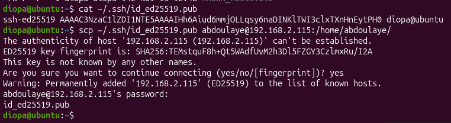

La commande `scp` (copie sécurisée, qui utilise SSH) demande le mot de passe du compte `abdoulaye` du client, une seule fois, car la clé n'est pas encore installée.

### 3.3 Vérification et autorisation de la clé sur le client

Sur le client Debian, on vérifie la présence de la clé publique dans le répertoire personnel, puis on l'ajoute au fichier `~/.ssh/authorized_keys`, qui liste les clés autorisées à se connecter au compte :

```bash
ls -l ~/id_ed25519.pub
mkdir -p ~/.ssh
cat ~/id_ed25519.pub >> ~/.ssh/authorized_keys
chmod 700 ~/.ssh
chmod 600 ~/.ssh/authorized_keys
cat ~/.ssh/authorized_keys
```

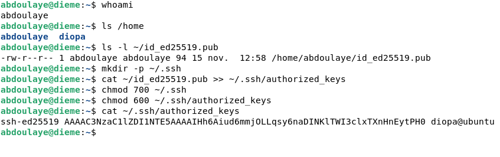

Les droits `700` sur `~/.ssh` et `600` sur `authorized_keys` sont nécessaires : par défaut, `sshd` refuse d'utiliser ces fichiers s'ils sont accessibles à d'autres utilisateurs.

### 3.4 Test de connexion sans mot de passe

```bash
ssh abdoulaye@192.168.2.115
whoami
hostname
exit
```

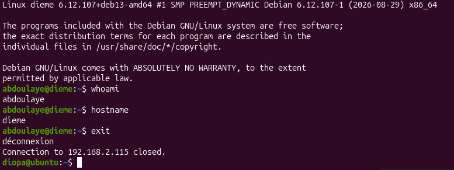

**Observation.** Aucun mot de passe n'est demandé : le client vérifie que le serveur possède la clé privée qui correspond à la clé publique enregistrée, et ouvre directement la session. Le prompt devient `abdoulaye@dieme:~$`, `whoami` renvoie `abdoulaye` et `hostname` renvoie `dieme`. Le test de connectivité demandé par le sujet est donc concluant.

## 4. Étape 4 : tunnel SSH en ligne de commande

Un tunnel SSH fait passer un autre protocole (HTTP, FTP, MySQL, etc.) à l'intérieur d'une connexion SSH. Tout le trafic est ainsi chiffré et transite par le seul port autorisé, le port 22. L'option `-L port_local:hôte:port_distant` ouvre un port sur la machine locale et en redirige le contenu, par le tunnel, vers `hôte:port_distant` vu depuis le serveur.

### 4.1 Préparation du serveur

Sur le serveur Ubuntu, on installe le serveur web Apache et la base de données MariaDB, puis on crée le compte `mame` demandé par le sujet :

```bash
sudo apt install -y apache2 mariadb-server
sudo systemctl enable --now apache2 mariadb
sudo adduser mame
```

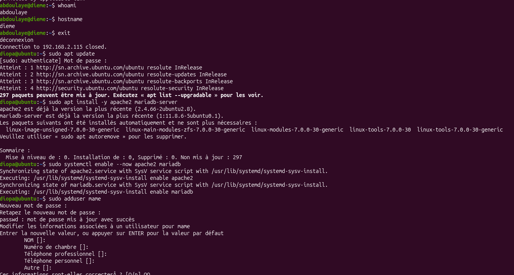

On crée une page d'accueil de test et une base de données `tpssh` contenant une table `etudiants`, avec un utilisateur SQL `mame` :

```bash
echo "<h1>Serveur web du TP SSH - Ubuntu 192.168.2.114</h1>" | sudo tee /var/www/html/index.html
sudo mariadb -e "SHOW DATABASES;"
sudo mariadb -e "SHOW TABLES FROM tpssh;"
sudo mariadb -e "INSERT INTO tpssh.etudiants VALUES (1,'Diop'),(2,'Dieme');"
sudo mariadb -e "SELECT * FROM tpssh.etudiants;"
```

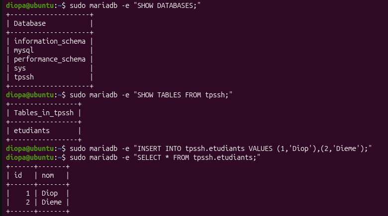

```bash
ss -tln
curl http://localhost
```

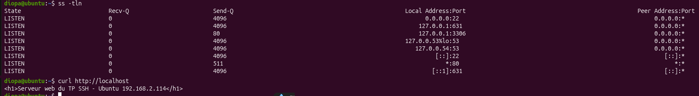

**Observation.** Apache écoute sur le port 80, sur toutes les interfaces. MariaDB écoute sur `127.0.0.1:3306` seulement : la base n'est donc pas accessible directement depuis une autre machine, et le tunnel SSH est le seul moyen d'y accéder à distance.

### 4.2 Tunnel vers le serveur web, depuis le client Windows

```powershell
ssh -L 1024:localhost:80 mame@192.168.2.114
```

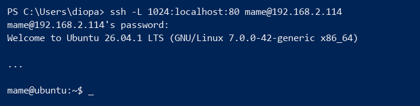

La session SSH reste ouverte : c'est elle qui maintient le tunnel. Dans un navigateur du PC Windows, on ouvre l'adresse `http://localhost:1024`. Le navigateur se connecte au port local 1024 ; SSH transporte la requête, chiffrée, jusqu'au serveur, qui la transmet à Apache sur son port 80 (`localhost` est interprété du côté du serveur).


### 4.3 Tunnel vers la base de données MariaDB

Le test est fait depuis le client Debian, qui dispose du client `mariadb`. Le tunnel est ouvert en arrière-plan (`-f`) sans ouvrir de shell (`-N`), et le port local 3307 est redirigé vers le port 3306 du serveur :

```bash
ssh -f -N -L 3307:localhost:3306 mame@192.168.2.114
ss -tln | grep 3307
mariadb -h 127.0.0.1 -P 3307 -u mame -p tpssh -e "SELECT * FROM etudiants;"
```

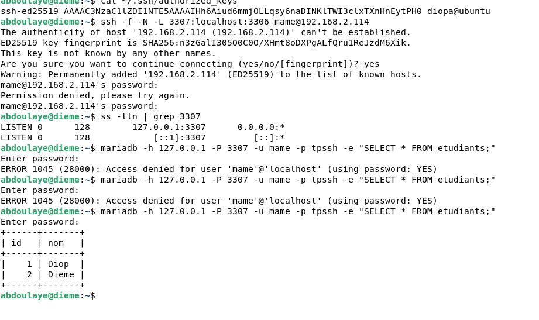

**Observation.** La commande `ss` montre le port 3307 en écoute sur le client. La requête passe par le tunnel et renvoie les deux lignes de la table `etudiants` du serveur (Diop et Dieme), alors que MariaDB n'écoute que sur `127.0.0.1` du serveur. Les deux premières tentatives ont échoué avec l'erreur `ERROR 1045 Access denied` : le mot de passe de la base avait été mal saisi. La troisième, avec le bon mot de passe, a réussi. Deux précisions : on utilise `-h 127.0.0.1` et non `localhost`, car le client MariaDB utiliserait alors le socket local et contournerait le tunnel ; et on choisit le port local 3307 pour ne pas entrer en conflit avec un éventuel MariaDB local sur le port 3306.

## Conclusion

Ce TP nous a permis de mettre en place le protocole SSH sur un serveur Linux et de l'utiliser de trois façons : une connexion classique par mot de passe depuis un client Windows, une connexion sans mot de passe grâce à une paire de clés ed25519, et des tunnels qui permettent d'accéder de façon chiffrée à un serveur web et à une base de données qui ne sont pas exposés directement. Les points à retenir sont les suivants :

- le serveur SSH écoute sur le port 22, que l'on vérifie avec `ss -tlnp` ;
- la clé privée reste secrète ; seule la clé publique est copiée, dans `authorized_keys`, avec les droits `700` et `600` ;
- un tunnel `-L port_local:hôte:port_distant` permet d'atteindre un service qui n'écoute qu'en local sur le serveur, comme MariaDB sur `127.0.0.1:3306`.
