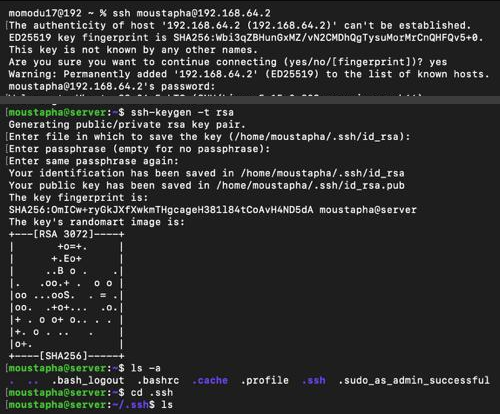
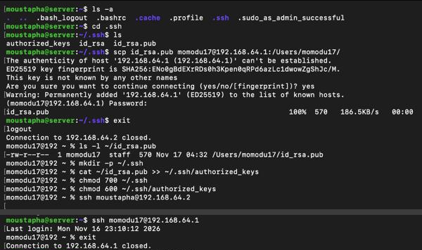
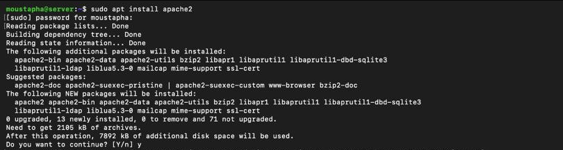
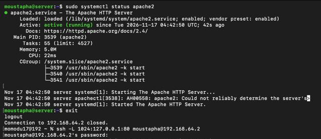
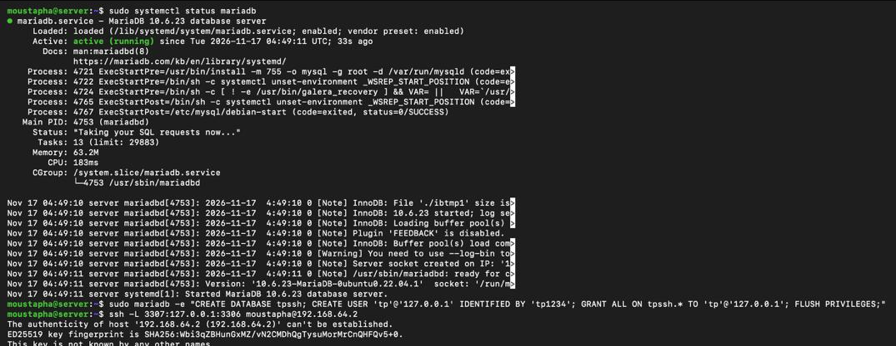
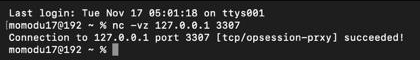
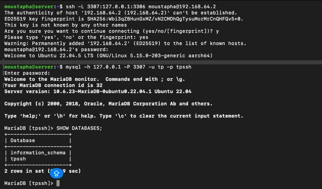

**Université Cheikh Anta Diop de Dakar**

**École Supérieure Polytechnique**

**Département Génie Informatique**

Année universitaire 2026-2027

Licence 3 GLSI

**Services Réseaux Avancés**

**TP : Mise en place du protocole SSH**

**COMPTE RENDU**

**Présenté par : Mamadou Moustapha Kane**

Formation : Licence 3 GLSI, ESP/UCAD

Enseignant : Dr GUEYE

*Dakar, novembre 2026*

# 1. Objectif et environnement

Ce TP met en place le protocole SSH entre un poste client et un serveur Linux : première connexion et vérification de l’empreinte du serveur, authentification par clé, puis utilisation de tunnels SSH (redirection de ports) pour accéder de façon chiffrée à deux services installés sur le serveur, Apache et MariaDB.

| **Machine**              | **Rôle**    | **Système**                     | **Adresse IP** | **Compte**                |
|--------------------------|-------------|---------------------------------|----------------|---------------------------|
| Mac (Apple M2)           | Client SSH  | macOS                           | 192.168.64.1   | momodu17                  |
| VM « serveur-ssh » (UTM) | Serveur SSH | Ubuntu Server 22.04.5 LTS ARM64 | 192.168.64.2   | moustapha (hôte : server) |

Le serveur OpenSSH est installé et actif sur la VM : toutes les connexions ci-dessous passent par lui. Les captures d’écran proviennent des terminaux du Mac (prompt momodu17@192) et de la VM (prompt moustapha@server).

# 2. Première connexion SSH et empreinte du serveur

> ssh moustapha@192.168.64.2

À la première connexion, le client ne connaît pas encore le serveur et affiche un message indiquant que l’authenticité de l’hôte ne peut pas être établie, avec l’empreinte (fingerprint) de sa clé d’hôte ED25519. Cette empreinte permet de vérifier qu’on parle bien au bon serveur et pas à un intermédiaire. Après vérification, on répond yes : la clé du serveur est enregistrée dans ~/.ssh/known_hosts, et le message n’apparaît plus aux connexions suivantes. Le mot de passe du compte moustapha est ensuite demandé.

*Figure 1 : première connexion SSH (empreinte acceptée) puis génération de la paire de clés avec ssh-keygen*

# 3. Génération de la paire de clés

Sur le serveur, la paire de clés RSA est générée avec la commande suivante :

> ssh-keygen -t rsa

- Le fichier de destination par défaut est /home/moustapha/.ssh/id_rsa. La passphrase est laissée vide (Entrée deux fois).

- id_rsa est la clé privée : elle reste secrète sur la machine qui l’a générée.

- id_rsa.pub est la clé publique : elle peut être copiée sur les machines auxquelles on veut se connecter.

- L’empreinte de la clé et son « randomart » sont affichés à la fin de la génération (RSA 3072 bits, visible sur la Figure 1).

Un ls dans le dossier ~/.ssh montre ensuite les fichiers authorized_keys, id_rsa et id_rsa.pub.

# 4. Échange de la clé publique et connexion sans mot de passe

La clé publique est copiée du serveur vers le Mac avec scp. Lors de ce premier accès au Mac, l’empreinte de celui-ci est acceptée à son tour, et le mot de passe du compte momodu17 est demandé :

> scp id_rsa.pub momodu17@192.168.64.1:/Users/momodu17/

Sur le Mac, la clé est ajoutée au fichier des clés autorisées, avec des droits stricts :

> ls -l ~/id_rsa.pub
>
> mkdir -p ~/.ssh
>
> cat ~/id_rsa.pub \>\> ~/.ssh/authorized_keys
>
> chmod 700 ~/.ssh
>
> chmod 600 ~/.ssh/authorized_keys

- cat ... \>\> authorized_keys : ajoute (sans écraser) la clé publique à la liste des clés autorisées à se connecter à ce compte.

- chmod 700 ~/.ssh et chmod 600 authorized_keys : le serveur SSH refuse les clés si ces droits sont trop ouverts.

Test : depuis le serveur, la commande ssh momodu17@192.168.64.1 ouvre la session sur le Mac immédiatement, sans demande de mot de passe : l’authentification par clé fonctionne. En revanche, la connexion du Mac vers le serveur (ssh moustapha@192.168.64.2) demande encore le mot de passe, car la clé installée sur le Mac autorise le serveur à se connecter au Mac, et non l’inverse.

*Figure 2 : copie de la clé publique avec scp, installation dans authorized_keys et connexion sans mot de passe*

# 5. Apache et tunnel SSH local

## 5.1 Installation et vérification du service

> sudo apt install apache2
>
> sudo systemctl status apache2

Treize nouveaux paquets sont installés depuis les dépôts Ubuntu ARM64 (Figure 3). L’état du service est ensuite vérifié : active (running).

*Figure 3 : installation d’Apache avec apt*

Le message AH00558 des journaux (nom de domaine du serveur non déterminé) est un simple avertissement : il signifie qu’aucun ServerName n’est défini, et n’empêche pas le service de démarrer.

## 5.2 Tunnel SSH vers le port 80

Depuis le Mac, on ouvre un tunnel :

> ssh -L 1024:127.0.0.1:80 moustapha@192.168.64.2

L’option -L port_local:hôte:port_distant redirige le port 1024 du Mac vers le port 80 vu depuis le serveur (127.0.0.1:80, donc Apache). Tout ce qui est envoyé sur 127.0.0.1:1024 sur le Mac est transporté, chiffré, par la connexion SSH. Le port 1024 est le premier port non privilégié : un port inférieur à 1024 aurait demandé les droits administrateur sur le Mac. La page d’Apache est alors accessible dans le navigateur du Mac à l’adresse http://127.0.0.1:1024, tant que la session SSH reste ouverte.

*Figure 4 : service apache2 actif et ouverture du tunnel SSH (port local 1024 vers port 80)*

*\[CAPTURE À INSÉRER : page d’accueil d’Apache dans le navigateur à l’adresse http://127.0.0.1:1024 (facultatif : à ajouter si tu l’as)\]*

# 6. MariaDB et tunnel SSH vers la base de données

## 6.1 Installation, service et base de test

> sudo apt install mariadb-server
>
> sudo systemctl status mariadb
>
> sudo mariadb -e "CREATE DATABASE tpssh; CREATE USER 'tp'@'127.0.0.1' IDENTIFIED BY '...'; GRANT ALL ON tpssh.\* TO 'tp'@'127.0.0.1'; FLUSH PRIVILEGES;"

- Le service mariadb (version 10.6.23) est actif (running).

- CREATE DATABASE tpssh : crée la base de test.

- CREATE USER 'tp'@'127.0.0.1' : crée l’utilisateur tp, autorisé uniquement depuis l’adresse locale 127.0.0.1, avec son mot de passe.

- GRANT ALL ON tpssh.\* : lui donne tous les droits sur cette seule base, et non sur tout le serveur.

- FLUSH PRIVILEGES : recharge les droits pour qu’ils soient pris en compte.

*Figure 5 : état du service mariadb, création de la base tpssh et de l’utilisateur tp, puis ouverture du tunnel*

## 6.2 Tunnel SSH vers le port 3306

> ssh -L 3307:127.0.0.1:3306 moustapha@192.168.64.2

Le port local 3307 est redirigé vers le port 3306 de MariaDB, côté serveur. Par défaut, MariaDB sur Ubuntu n’écoute que sur l’adresse locale 127.0.0.1 : la base n’est donc pas joignable directement depuis le réseau, et le tunnel SSH est le moyen d’y accéder à distance de façon chiffrée.

## 6.3 Tests

Test de la redirection depuis le Mac avec netcat :

> nc -vz 127.0.0.1 3307

Le message « Connection to 127.0.0.1 port 3307 ... succeeded! » confirme que le port local du tunnel est ouvert (Figure 6).

*Figure 6 : test du port local 3307 avec nc -vz*

Connexion à la base à travers le tunnel :

> mysql -h 127.0.0.1 -P 3307 -u tp -p tpssh
>
> SHOW DATABASES;

L’option -h 127.0.0.1 force une connexion réseau (et non par le socket local) et -P 3307 désigne le port du tunnel. Le moniteur MariaDB s’ouvre (serveur 10.6.23) et SHOW DATABASES liste information_schema et tpssh, la base à laquelle l’utilisateur tp a accès (Figure 7).

*Figure 7 : tunnel SSH vers MariaDB, connexion avec l’utilisateur tp et liste des bases*

# 7. Récapitulatif

| **Service** | **Port serveur** | **Port local** | **Commande du tunnel**                            |
|-------------|------------------|----------------|---------------------------------------------------|
| Apache      | 80               | 1024           | ssh -L 1024:127.0.0.1:80 moustapha@192.168.64.2   |
| MariaDB     | 3306             | 3307           | ssh -L 3307:127.0.0.1:3306 moustapha@192.168.64.2 |

# Conclusion

Ce TP a permis de mettre en œuvre SSH de bout en bout : vérification de l’empreinte du serveur à la première connexion, génération d’une paire de clés et authentification par clé sans mot de passe, puis utilisation de tunnels SSH pour atteindre Apache (port 1024) et MariaDB (port 3307) à travers une connexion chiffrée. Les points à retenir sont la protection de la clé privée, les droits stricts sur ~/.ssh et authorized_keys, et le fait qu’un tunnel permet d’accéder à un service qui n’écoute qu’en local sans l’exposer sur le réseau.
