DGI-ESP — 2026-2027

Licence 3 GLSI — Services Réseaux Avancés

École Supérieure Polytechnique (ESP/UCAD), Dakar

Compte rendu de TP

**Configuration et utilisation de VNC et noVNC**

Prise de contrôle à distance d’une machine Linux : TigerVNC, tunnel SSH et accès par navigateur avec noVNC

**Étudiant :** Mamadou Moustapha KANE

**Enseignant :** Dr GUEYE

**Date :** 24 novembre 2026

# 1. Introduction et environnement

L’objectif de ce TP est de mettre en place une prise de contrôle graphique à distance d’une machine Linux. Le TP se déroule en deux temps : d’abord un serveur VNC (TigerVNC avec le bureau XFCE) auquel on se connecte avec un client VNC, puis la sécurisation de cette connexion par un tunnel SSH ; ensuite un accès depuis un simple navigateur web grâce à noVNC et websockify.

## 1.1 Environnement de travail

| **Élément**          | **Valeur**                                                                                                                          |
|----------------------|-------------------------------------------------------------------------------------------------------------------------------------|
| **Serveur**          | Machine virtuelle Ubuntu Server 22.04.5 LTS (ARM64) sous UTM, nom d’hôte « server », utilisateur moustapha, adresse IP 192.168.64.2 |
| **Client**           | Mac (Apple M2) sous macOS, adresse IP 192.168.64.1                                                                                  |
| **Réseau**           | Réseau partagé UTM (192.168.64.0/24) entre le Mac et la VM                                                                          |
| **Serveur VNC**      | TigerVNC 1.12.0 (paquet tigervnc-standalone-server), session :1 sur le port 5901                                                    |
| **Bureau**           | XFCE 4 (xfce4 et xfce4-goodies)                                                                                                     |
| **noVNC**            | Dépôt GitHub cloné dans /opt/noVNC, avec websockify 0.13.0 (installé avec pip)                                                      |
| **Clients utilisés** | Partage d’écran (client VNC intégré à macOS) et navigateur web (Safari)                                                             |

# 2. Partie 1 : installation et configuration du serveur VNC

## Étape 1 : mise à jour de la machine

Les commandes ci-dessous sont exécutées dans la VM. La mise à jour a installé un nouveau noyau (5.15.0-204) ; la VM a donc été redémarrée pour le charger.

> sudo apt update && sudo apt upgrade -y
>
> sudo reboot

## Étape 2 : installation de TigerVNC

> sudo apt install tigervnc-standalone-server -y

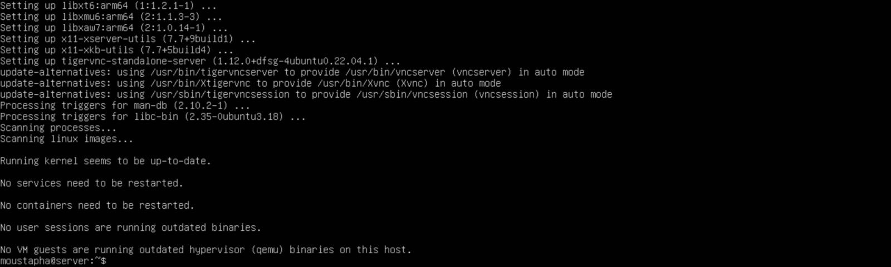

*Figure 1 — Fin de l’installation du paquet tigervnc-standalone-server*

## Étape 3 : installation de l’environnement de bureau

La VM est un serveur sans interface graphique. On installe donc XFCE, un bureau léger.

> sudo apt install xfce4 xfce4-goodies -y

## Étapes 4 et 5 : initialisation puis arrêt du serveur VNC

La première exécution de vncserver demande de créer le mot de passe VNC (aucun mot de passe en lecture seule n’a été défini). Le numéro de display :1 correspond au port TCP 5901 (5900 + 1). Le serveur est ensuite arrêté pour pouvoir modifier son fichier de démarrage.

> vncserver :1
>
> vncserver -kill :1

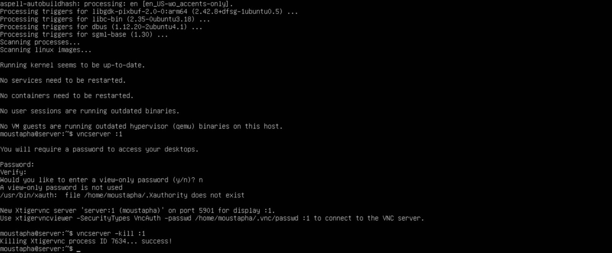

*Figure 2 — Fin de l’installation de XFCE, création du mot de passe VNC (display :1, port 5901), puis arrêt du serveur*

## Étape 6 : configuration du fichier xstartup

Le fichier ~/.vnc/xstartup indique quel bureau lancer au démarrage de la session. Il a d’abord été rédigé comme dans l’énoncé du TP, puis rendu exécutable.

> nano ~/.vnc/xstartup
>
> chmod +x ~/.vnc/xstartup
>
> \#!/bin/bash
>
> xrdb \$HOME/.Xresources
>
> startxfce4 &

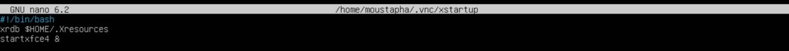

*Figure 3 — Contenu du fichier xstartup (version de l’énoncé)*

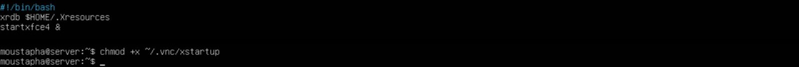

*Figure 4 — Contenu du fichier et commande chmod +x*

## Étape 7 : relance du serveur VNC et problème rencontré

Avec le fichier xstartup de l’énoncé, la session VNC s’arrête presque tout de suite après son démarrage.

> vncserver :1

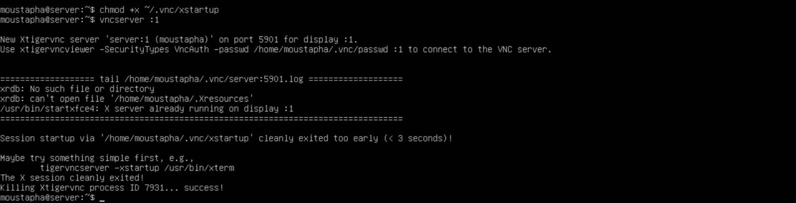

*Figure 5 — Échec : la session s’arrête (« cleanly exited too early ») car startxfce4 ne démarre pas correctement*

Le journal indique que xrdb ne trouve pas le fichier ~/.Xresources (sans gravité) et que startxfce4 se termine aussitôt (« X server already running on display :1 »). La cause probable est un lancement de startxfce4 en arrière-plan, sans session D-Bus dédiée : le script se termine immédiatement et TigerVNC arrête la session. La correction consiste à lancer XFCE au premier plan avec exec et dbus-launch :

> \#!/bin/bash
>
> unset SESSION_MANAGER
>
> unset DBUS_SESSION_BUS_ADDRESS
>
> \[ -r \$HOME/.Xresources \] && xrdb \$HOME/.Xresources
>
> exec dbus-launch --exit-with-session startxfce4

Après cette modification, le serveur démarre correctement et reste actif sur le port 5901.

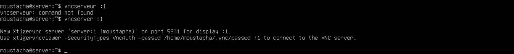

*Figure 6 — Le serveur VNC démarre et reste actif (display :1, port 5901)*

# 3. Partie 2 : connexion depuis la machine cliente

## Étape 1 : choix du client VNC

RealVNC Viewer (v8.6.2) a été installé sur le Mac, mais cette version impose la création d’un compte RealVNC pour démarrer. J’ai donc utilisé à la place le client VNC intégré à macOS, « Partage d’écran », lancé depuis le Terminal du Mac :

> open vnc://192.168.64.2:5901

## Étape 2 : échec de la première connexion et diagnostic

La première tentative de connexion échoue : macOS affiche « Échec de la connexion avec 192.168.64.2:5901 ». Pour comprendre, on regarde sur le serveur quelles adresses écoutent sur le port 5901.

> ss -tln \| grep 5901

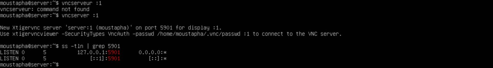

*Figure 7 — Le port 5901 écoute uniquement sur 127.0.0.1 : les connexions venant du Mac sont refusées*

Le serveur n’accepte que les connexions locales (127.0.0.1). On l’arrête puis on le relance en autorisant les connexions distantes avec l’option -localhost no, puis on vérifie à nouveau.

> vncserver -kill :1
>
> vncserver :1 -localhost no
>
> ss -tln \| grep 5901

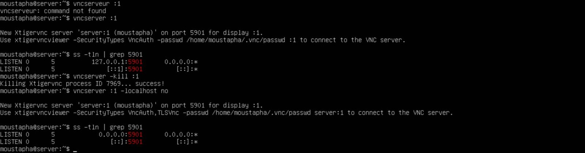

*Figure 8 — Après relance avec -localhost no, le port 5901 écoute sur 0.0.0.0 (toutes les interfaces)*

## Étape 3 : connexion et test

Après relance, la connexion depuis le Mac fonctionne : le mot de passe VNC est demandé et le bureau XFCE du serveur s’affiche dans la fenêtre de Partage d’écran. Le bureau répond à la souris et au clavier, et un terminal peut être ouvert dans la session.

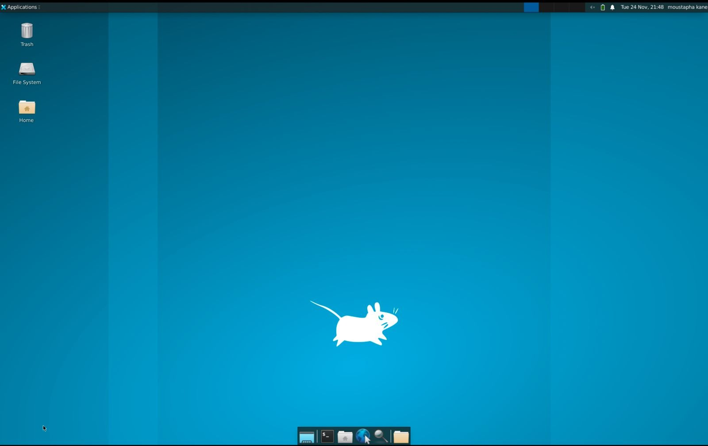

*Figure 9 — Bureau XFCE du serveur affiché sur le Mac via VNC (connexion directe sur le port 5901)*

# 4. Partie 3 : sécurisation avec un tunnel SSH

VNC ne chiffre pas correctement le trafic. Un tunnel SSH permet de faire passer toute la connexion VNC dans un canal chiffré.

## Étape 1 : création du tunnel SSH

Sur le Mac, on redirige le port local 5901 vers le port 5901 du serveur à travers SSH. La session SSH doit rester ouverte tant que l’on utilise le tunnel.

> ssh -L 5901:localhost:5901 moustapha@192.168.64.2

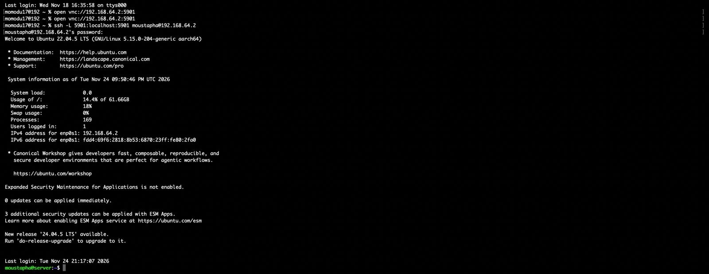

*Figure 10 — Tunnel SSH ouvert depuis le Mac (connexion au serveur, prompt moustapha@server)*

## Étape 2 : connexion VNC via le tunnel

Le client VNC se connecte maintenant à localhost:5901 au lieu de l’adresse IP du serveur : le trafic entre dans le tunnel sur le Mac et ressort sur le serveur.

> open vnc://localhost:5901

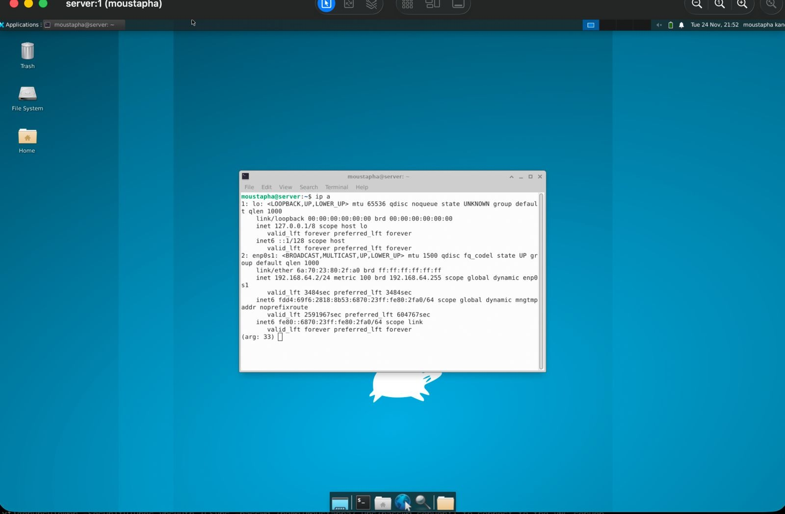

*Figure 11 — Bureau XFCE via le tunnel ; le terminal affiche ip a avec l’adresse du serveur 192.168.64.2*

## Étape 3 : vérification du passage par SSH

Dans la session distante, on consulte le journal d’authentification du serveur.

> sudo tail -n 20 /var/log/auth.log

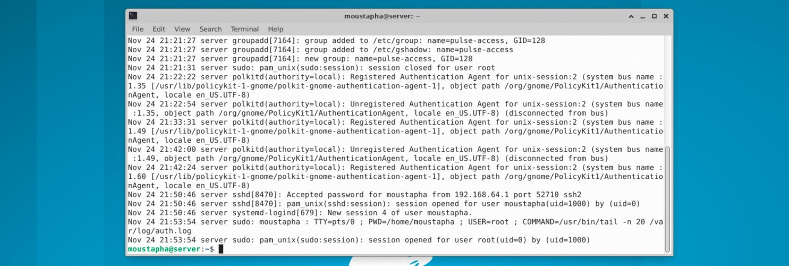

*Figure 12 — Journal auth.log : connexion SSH acceptée pour moustapha depuis 192.168.64.1 (21:50:46)*

Les lignes sshd montrent « Accepted password for moustapha from 192.168.64.1 » et l’ouverture de session à l’heure où le tunnel a été créé. Cela confirme que la connexion VNC passe bien par SSH.

**Remarque de sécurité :** dans ce TP, le serveur VNC écoute sur toutes les interfaces (-localhost no), donc un client peut encore s’y connecter sans tunnel. Pour imposer le passage par le tunnel, il faudrait relancer le serveur avec -localhost yes, ce qui le rend accessible uniquement depuis la machine elle-même.

# 5. TP noVNC : accès par navigateur web

## Étape 1 : installation de noVNC

TigerVNC est déjà installé (voir la partie 1). On installe git, puis on clone le dépôt noVNC dans /opt.

> sudo apt install git -y
>
> cd /opt
>
> sudo git clone https://github.com/novnc/noVNC.git
>
> cd /opt/noVNC
>
> ls

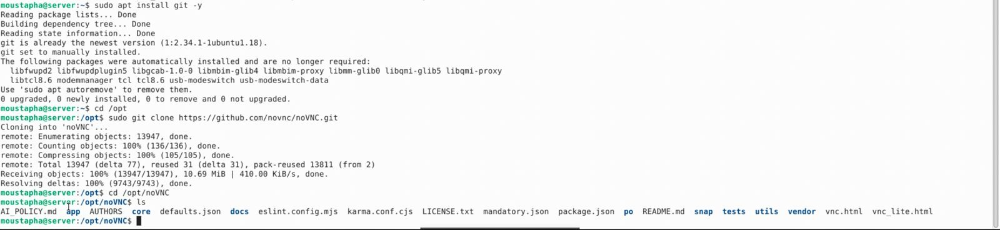

*Figure 13 — Clonage du dépôt noVNC dans /opt et contenu du répertoire*

## Installation de websockify

> sudo apt install python3-pip -y
>
> sudo pip3 install websockify

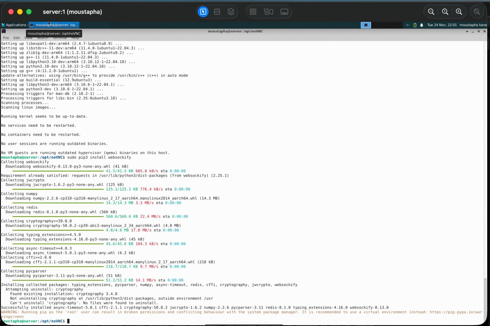

*Figure 14 — Installation de websockify 0.13.0 avec pip (affichée dans la session VNC)*

pip affiche un avertissement car il est lancé avec sudo (installation dans l’environnement Python du système). L’installation s’est terminée avec succès.

## Étape 2 : session VNC

La session VNC (display :1, port 5901) et le fichier xstartup ont déjà été configurés dans la partie 1. Ils sont réutilisés tels quels. noVNC se connecte au serveur VNC en local (localhost:5901).

## Étape 3 : lancement de noVNC

> cd /opt/noVNC
>
> ./utils/novnc_proxy --vnc localhost:5901

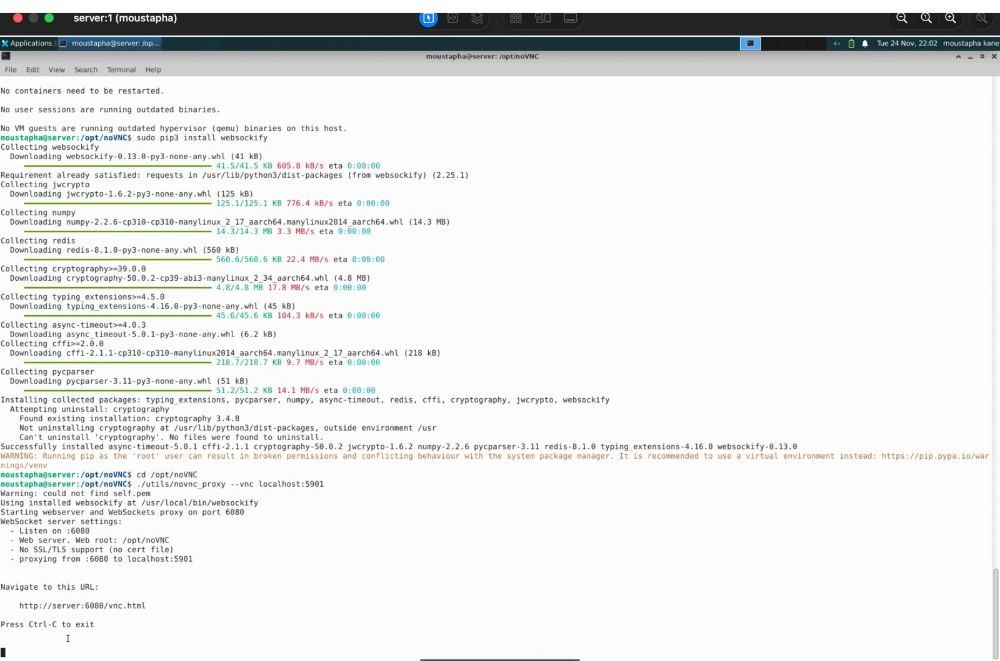

*Figure 15 — noVNC démarre : écoute sur le port 6080, racine web /opt/noVNC, proxy vers localhost:5901*

Le script lance websockify, qui sert à la fois les pages web de noVNC et le proxy WebSocket vers le port 5901. Le message « No SSL/TLS support (no cert file) » indique que la connexion n’est pas chiffrée par défaut (pas de certificat self.pem).

## Accès à noVNC depuis le navigateur

Sur le Mac, on ouvre dans le navigateur l’adresse http://192.168.64.2:6080/vnc.html, puis on clique sur « Connecter » et on saisit le mot de passe VNC.

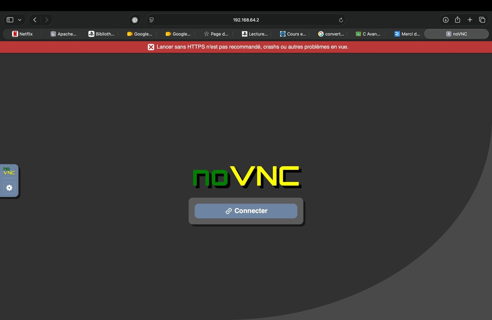

*Figure 16 — Page d’accueil de noVNC ; le navigateur signale l’absence de HTTPS*

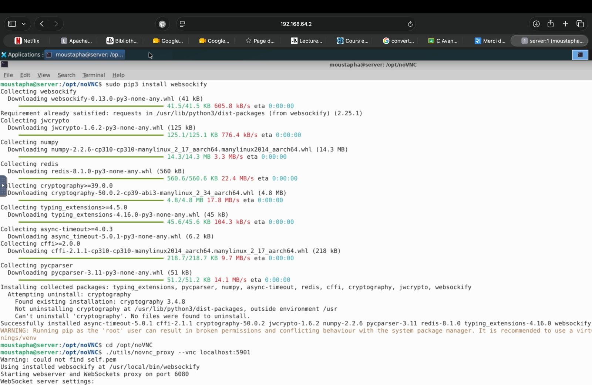

*Figure 17 — Bureau XFCE du serveur affiché dans le navigateur (accès direct par l’IP)*

## Étape 5 : sécurisation avec un tunnel SSH (optionnel)

On crée un tunnel SSH qui redirige le port local 6080 du Mac vers le port 6080 du serveur, puis on accède à noVNC via localhost.

> ssh -L 6080:localhost:6080 moustapha@192.168.64.2

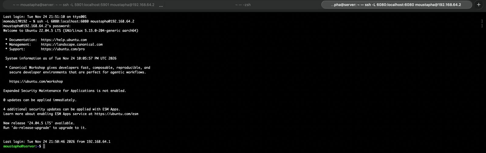

*Figure 18 — Tunnel SSH pour noVNC (port 6080) ouvert depuis le Mac*

Dans le navigateur, on ouvre ensuite http://localhost:6080/vnc.html : le bureau s’affiche, cette fois à travers le tunnel SSH chiffré.

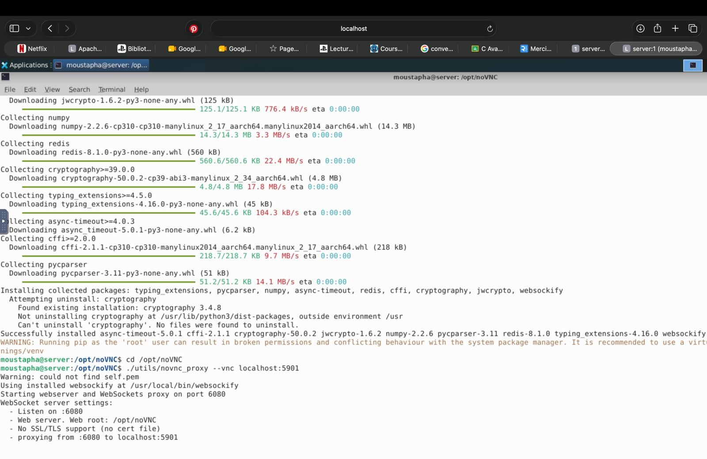

*Figure 19 — noVNC via le tunnel SSH (adresse localhost:6080)*

## Étape 6 : tests et vérification

Connexion VNC : le bureau XFCE s’affiche dans le navigateur, aussi bien en accès direct (figure 17) qu’à travers le tunnel (figure 19), et le terminal reste utilisable.

Stabilité du service : la VM a été redémarrée, puis on a regardé si les ports 5901 (VNC) et 6080 (noVNC) étaient de nouveau à l’écoute.

> sudo reboot
>
> ss -tln \| grep -E '5901\|6080'

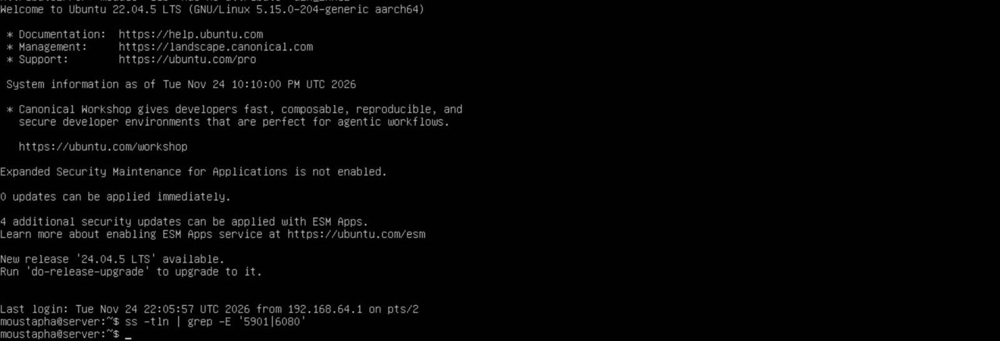

*Figure 20 — Après redémarrage, aucun service n’écoute sur les ports 5901 et 6080*

La commande ne renvoie aucune ligne : ni le serveur VNC ni noVNC ne redémarrent automatiquement. Ils ont été lancés à la main, et non comme des services. Après un redémarrage, il faut donc relancer vncserver puis novnc_proxy. Pour automatiser, il faudrait créer des services (par exemple des unités systemd) ; cela n’a pas été fait dans ce TP.

# 6. Questions de réflexion

### Quelle est l’utilité de websockify dans l’architecture de noVNC ?

Un navigateur ne sait pas ouvrir une connexion TCP brute vers un serveur VNC : il ne parle que HTTP et WebSocket. Websockify fait le pont entre les deux. Il reçoit les connexions WebSocket envoyées par noVNC dans le navigateur et les retransmet en TCP au serveur VNC (port 5901), et inversement. Dans ce TP, il sert aussi les fichiers web de noVNC sur le port 6080.

### Quelles sont les différences entre noVNC et les autres clients VNC standards ?

noVNC est un client VNC écrit en HTML5 et JavaScript qui s’exécute dans le navigateur, sans rien installer sur la machine cliente. Il a besoin de websockify côté serveur. Les clients standards (RealVNC Viewer, TigerVNC Viewer, Partage d’écran de macOS) sont des applications installées sur le client qui se connectent directement au serveur VNC en TCP.

### Quels sont les avantages et inconvénients de noVNC par rapport à une application VNC native ?

|                   | **Détail**                                                                                                                                                                                                                                                                     |
|-------------------|--------------------------------------------------------------------------------------------------------------------------------------------------------------------------------------------------------------------------------------------------------------------------------|
| **Avantages**     | Aucune installation sur le client ; fonctionne sur tout appareil doté d’un navigateur (multiplateforme) ; accès simple par une adresse web.                                                                                                                                    |
| **Inconvénients** | Un composant de plus à installer et à lancer sur le serveur (websockify), donc un peu plus de latence ; moins de fonctionnalités et de performances qu’un client natif ; pas de chiffrement par défaut (HTTP et WebSocket en clair), d’où l’intérêt du tunnel SSH ou du HTTPS. |

# 7. Difficultés rencontrées

| **Problème**                                                                  | **Cause**                                                                                                                                             | **Solution**                                                                                     |
|-------------------------------------------------------------------------------|-------------------------------------------------------------------------------------------------------------------------------------------------------|--------------------------------------------------------------------------------------------------|
| **La session VNC s’arrête juste après le démarrage**                          | Le fichier xstartup de l’énoncé lance startxfce4 en arrière-plan, sans session D-Bus dédiée (cause probable)                                          | Nouveau xstartup avec unset des variables, exec et dbus-launch --exit-with-session               |
| **Connexion refusée depuis le Mac**                                           | TigerVNC écoutait seulement sur 127.0.0.1:5901                                                                                                        | Relance avec vncserver :1 -localhost no                                                          |
| **RealVNC Viewer demande un compte**                                          | La version 8.6.2 impose la connexion à un compte RealVNC pour démarrer                                                                                | Utilisation de Partage d’écran, le client VNC de macOS                                           |
| **Erreur Python à l’ouverture de session après l’installation de websockify** | pip a installé une version plus récente de la bibliothèque cryptography, en conflit probable avec un paquet du système (AttributeError sur GEN_EMAIL) | Aucun effet observé sur VNC ni noVNC ; un environnement virtuel Python évite ce genre de conflit |

# 8. Conclusion

Ce TP a permis de configurer un serveur VNC (TigerVNC avec XFCE) sur une machine Ubuntu, de s’y connecter depuis un Mac, puis de sécuriser la connexion avec un tunnel SSH, dont le passage a été vérifié dans les journaux du serveur. noVNC et websockify permettent ensuite de prendre le contrôle du bureau depuis un simple navigateur, sans logiciel client, y compris à travers un tunnel SSH.

Deux points de vigilance sont ressortis. Le serveur VNC doit être configuré avec soin (fichier xstartup, option -localhost) pour être joignable de la bonne manière. Et ni VNC ni noVNC ne sont chiffrés par défaut : en pratique, il faut les utiliser derrière un tunnel SSH ou en HTTPS, et créer des services pour qu’ils redémarrent avec la machine.
